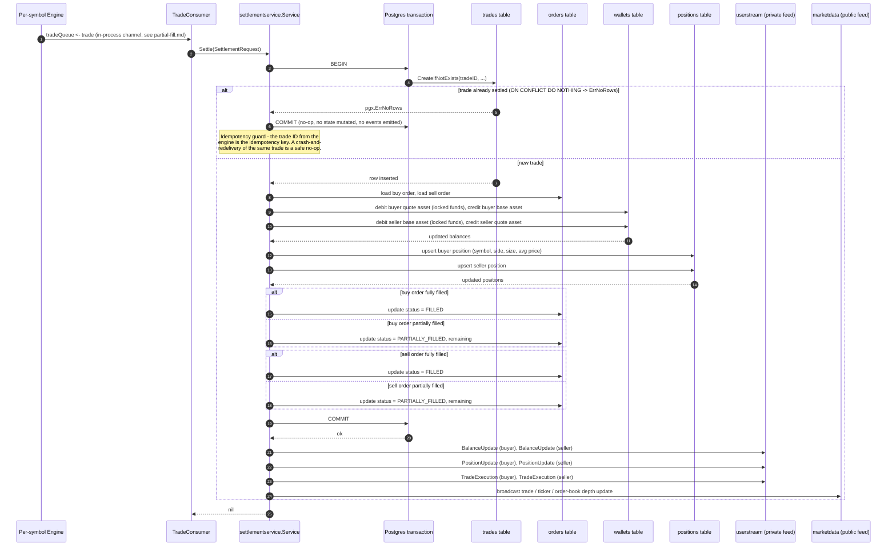

# Sequence Diagram: Full Fill and Settlement

## Purpose

Traces a trade from execution inside the matcher through to it being
durably settled in Postgres — wallet balances updated, positions
updated, order status finalized. This picks up where
[`partial-fill.md`](partial-fill.md) leaves off, at the point a
`trade.Trade` is produced, and follows the case where the trade fully
settles cleanly (no retry, no DLQ).

## Participants and source references

| Participant | Source |
|---|---|
| Per-symbol engine | `internal/engine/engine.go` (`applyCommand`) |
| Trade consumer | `internal/persistence/worker/trade_consumer.go` |
| Settlement service | `internal/service/settlementservice/service.go` (`Settle`) |
| Wallet service | `internal/service/walletservice/service.go` |
| Postgres (transactional) | `internal/persistence/postgres/repository/*` |
| Per-user WebSocket | `internal/userstream` |
| Public WebSocket / market data | `internal/marketdata` |

## Diagram

## Important: this differs from the architecture described in the README

The top-level `README.md` describes settlement like this:

> "trades produced by the engine are published as events, consumed
> asynchronously by a worker process, and settled transactionally
> against wallets, positions, and order state in PostgreSQL."

and lists `cmd/worker` as: "entry point: Kafka consumer that runs
**settlement** and analytics."

**That is not what the code currently does.** Based on
`internal/app/bootstrap.go` (the `api` binary's bootstrap, not the
worker's):

- `worker.NewTradeConsumer(...)` — the thing that actually calls
  `settlementservice.Service.Settle` — is constructed and wired **inside
  the `api` process**.
- It is wired directly to the engine's own `Trades()` Go channel
  (`internal/engine/registry/registry.go`, `consumer.Start(ctx,
  engine.Trades())`), **not** to a Kafka consumer.
- The separate `cmd/worker` binary (`internal/app/worker_bootstrap.go`)
  only starts a Kafka consumer for the **audit/analytics** pipeline
  (`EventAuditSubscriber`, candle backfill, rolling stats) - see the doc
  comment on `EventAuditSubscriber` itself, which says this explicitly:
  *"settlement already happens synchronously in-process... This
  subscriber exists to prove the Kafka pipeline works end-to-end... and
  as a seam for future consumers."*

**Practical implications of the real (in-process) architecture:**

- Settlement happens **synchronously in the same process as order
  intake**, on a dedicated goroutine reading a Go channel - not
  asynchronously in a separate, independently-scalable worker fleet.
- If the `api` process is down, **no settlement happens at all** - there
  is no separate `worker` process picking up the slack for settlement
  (only for audit/analytics).
- This is consistent with the single-instance hosting constraint noted
  elsewhere for the matching engine itself (see the hosting discussion):
  since `api` can only safely run as one instance anyway, having
  settlement live inside it is not obviously wrong - but it does mean
  `cmd/worker`'s README description is misleading, and scaling
  settlement independently of order intake is not currently possible
  without restructuring this wiring.

This is worth reconciling deliberately - either fix the README/`cmd/worker`
description to match reality, or actually move settlement onto the Kafka
pipeline (through `cmd/worker`) so the code matches the documented,
originally-intended design. Right now, the documentation and the code
disagree, and this file describes the code as it actually behaves.