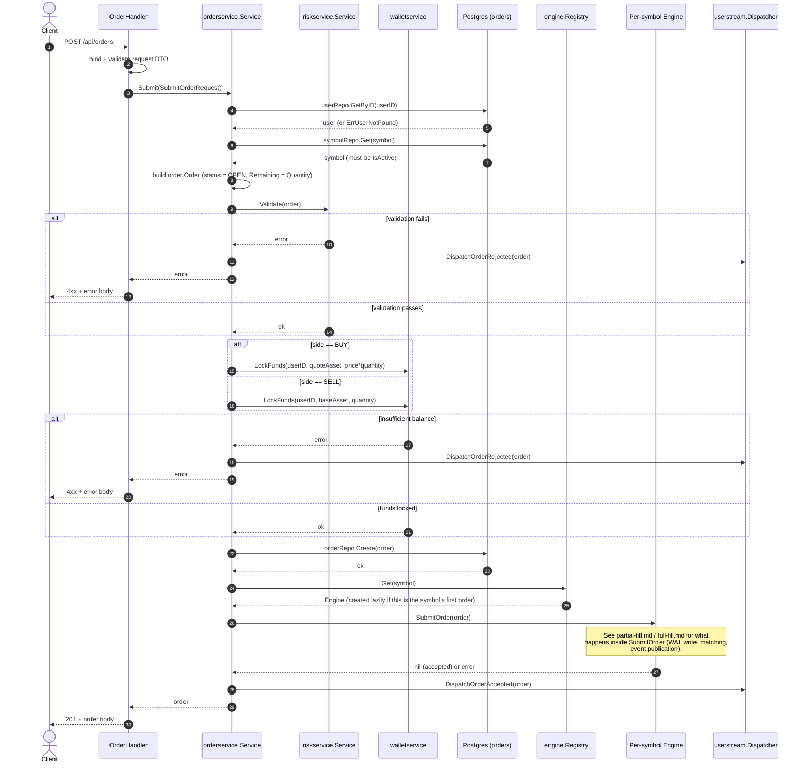

# Sequence Diagram: Order Placement

## Purpose

Traces a single `POST /api/orders` request from the HTTP boundary through
risk validation, fund locking, persistence, and acceptance into the
matching engine. This is the "before matching" half of the order
lifecycle — see [`partial-fill.md`](partial-fill.md) and
[`full-fill.md`](full-fill.md) for what happens once the order reaches
the matcher.

## Participants and source references

| Participant | Source |
|---|---|
| HTTP handler | `internal/transport/http/handler/order_handler.go` (`Submit`) |
| Order service | `internal/service/orderservice/service.go` (`Submit`) |
| Risk service | `internal/service/riskservice/service.go` (`Validate`) |
| Wallet service | `internal/service/walletservice/service.go` (`LockFunds`) |
| Order repository | `internal/persistence/postgres/repository/order_repository_impl.go` |
| Engine registry | `internal/engine/registry/registry.go` (`Get`) |
| Per-symbol engine | `internal/engine/engine.go` (`SubmitOrder`) |
| User WebSocket dispatcher | `internal/userstream/dispatcher.go` |

## Diagram

## Notes

- **Funds are locked before the order reaches the engine**, not after a
  trade settles. This is what backs the "insufficient balance" rejection
  path — the engine itself never checks wallet balances.
- **The order row is written to Postgres before `SubmitOrder` is called.**
  If the process crashes between `orderRepo.Create` and the engine
  accepting the order, the order exists in the database but was never
  seen by the matching engine. Recovery on restart replays the WAL, not
  the orders table, so this ordering matters for reasoning about crash
  windows.
- **`Registry.Get(symbol)` is where a symbol's engine is lazily created**
  if this is the first order ever submitted for it (see
  `docs/architecture/04-engine-registry.md`). The first order for a new
  symbol therefore pays engine-startup cost inline with the request.
- `DispatchOrderAccepted` / `DispatchOrderRejected` push to the
  **authenticated per-user WebSocket feed** (`/ws/private`), not to
  Kafka. This is a separate delivery path from the engine's own
  `events.Event` publication used for trade/order-book events (see
  `full-fill.md`).
- Stop orders (`STOP_MARKET` / `STOP_LIMIT`) short-circuit inside
  `Engine.SubmitOrder` / `applyCommand` before reaching the matcher — they
  are placed in the stop book (`status = PENDING`) and are not written to
  the WAL today (see the comment in `internal/engine/engine.go`,
  `processBatch`). That is a known, pre-existing durability gap, not
  something this diagram's flow hides.